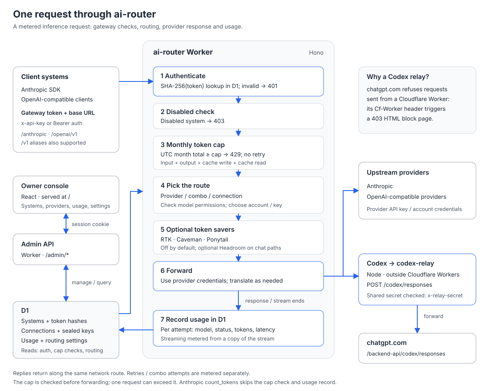
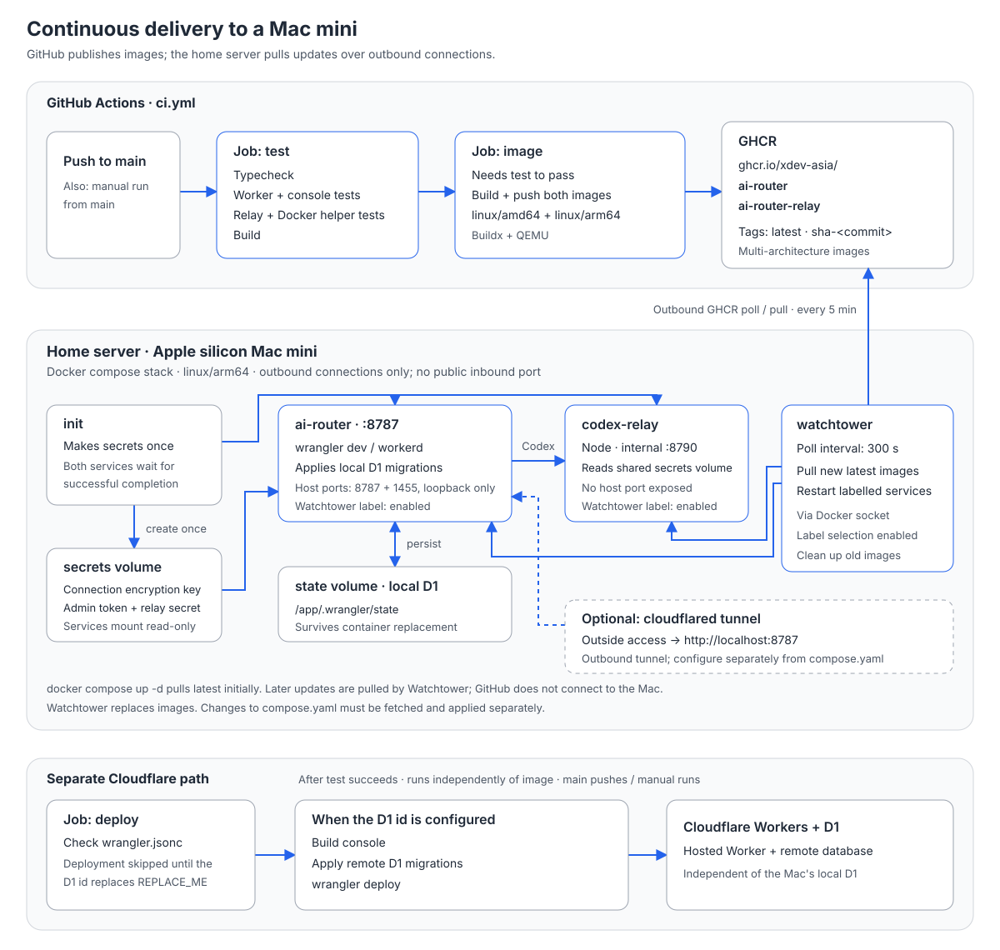

# xDev AI Router

One place that holds the provider keys for every xDev system (chat, `xdevd`, ...). A Worker (Hono) backed by D1,
with an owner console built from `@xdev-asia/ui`. It runs in Docker on one machine, a Mac mini (workerd through
`wrangler dev`, local D1), and updates itself from the images CI builds ([On a Mac mini](#on-a-mac-mini-apple-silicon-updated-on-every-push)).

Each system keeps using the provider's official SDK and only changes the base URL and the key:

```ts
import Anthropic from "@anthropic-ai/sdk";

const client = new Anthropic({ apiKey: process.env.LLM_GATEWAY_TOKEN, baseURL: "https://<gateway host>/anthropic" });
```

## Credits

Some files and data come from other open-source projects, among them [9router](https://github.com/decolua/9router)
(MIT): the token-saver filters, the model catalog, default prices, provider data and logo files.
[THIRD_PARTY_NOTICES.md](THIRD_PARTY_NOTICES.md) lists each one with its license.

## What it does



| Step | Rule |
|---|---|
| Authenticate | The system's gateway token in `x-api-key` (what the SDK sends) or `Authorization: Bearer`. Stored as SHA-256 only |
| Disable | A disabled system gets `403 permission_error` |
| Cap | Tokens this UTC month (input + output + cache write + cache read) checked before the request; at or over the cap: `429 rate_limit_error` with `x-should-retry: false`. One request can go over the cap; the next one is refused |
| Forward | `POST /anthropic/v1/messages` and `/anthropic/v1/messages/count_tokens`, query string kept. Only `anthropic-version`, `anthropic-beta`, `content-type` and `accept` are passed on; the key becomes the system's Anthropic key |
| Meter | One `usage` row per Messages request: model, status, token counts, request id, and the time from the request's arrival to the provider's last byte. Streaming replies are read on a copy of the stream. No request or response content is stored |

For Anthropic-format models (Claude, the `claude/` sign-in, Anthropic-compatible custom providers) the body is not
changed, so thinking, caching, tools and fallbacks work as when calling Anthropic directly.

Any other model or a combo on `/v1/messages` (Claude Code with `ANTHROPIC_MODEL=combo/fast`, say) is translated to
chat, routed like `/v1/chat/completions`, and answered as a Claude message or event stream
(`worker/translate/anthropic-openai.ts`). Left out on the way: `cache_control`, thinking blocks of earlier turns, and
server tools such as `web_search_*`, which only Anthropic runs. A combo with a Claude model goes this way too, so it
loses prompt caching; an alias of a Claude model (without a `(level)` suffix) is forwarded as sent. `count_tokens` for
translated models is a local estimate, about four characters per token. Thinking blocks with no signature, which a
translated answer leaves in the client's history, are removed before a request is forwarded to Anthropic.

A client that goes away before the provider answers ends the provider request: the answer is `499`, no account is set
aside and no other one is tried. This needs the `enable_request_signal` compatibility flag (in `wrangler.jsonc`) while
the compatibility date is before 2026-11-17.

## Secrets and setup

| Name | Kind | Value |
|---|---|---|
| `ANTHROPIC_KEYS` | secret | JSON object, system id -> that system's Anthropic API key. One key per system, ideally one Anthropic workspace per system |
| `ADMIN_TOKEN_SHA256` | secret | SHA-256 hex of the owner's admin token. Unset: the token is refused (xDev ID sign-in still works) |
| `PROVIDER_KEYS` | secret | JSON object, provider id -> its official API key: `{"openai": "sk-...", "gemini": "...", "openrouter": "sk-or-...", "deepseek": "sk-...", "groq": "gsk_..."}`. Shared by the systems allowed to use that provider |
| `CONNECTIONS_KEY` | secret | 32 random bytes, base64 (`openssl rand -base64 32`). Seals the credentials of the connections stored in D1. Unset: connections cannot be added or used. Changing it makes the stored connections unreadable |
| `OIDC_CLIENT_SECRET` | secret | This gateway's client secret at xDev ID |
| `ANTHROPIC_BASE_URL` | var | `https://api.anthropic.com` |
| `OIDC_ISSUER` | var | `https://id.xdev.asia/api/auth` |
| `OIDC_CLIENT_ID` | var | This gateway's client id at xDev ID. Empty: xDev ID sign-in is off |
| `CONSOLE_EMAILS` | var | Comma-separated xDev account emails (verified) allowed into the console |
| `CODEX_RELAY_URL` | var | Base URL of the Codex relay (`https://relay.example.com`). Unset: Codex requests go straight to chatgpt.com, which refuses them from a Worker ([Codex relay](#codex-relay)) |
| `CODEX_RELAY_SECRET` | secret | The relay's `RELAY_SECRET` (`openssl rand -base64 32`). Required when `CODEX_RELAY_URL` is set |
| `STUDIO_URL` | var | Base URL of [Clip Studio](#clip-studio) (`http://studio:8791` in compose). Unset: the Clips page says the studio is not set up |
| `STUDIO_SECRET` | secret | The studio's `STUDIO_SECRET`. Required when `STUDIO_URL` is set |

All of them go in `.dev.vars` next to `compose.yaml` on the server (git-ignored, one `NAME=value` per line), and
all are optional. On the first `docker compose up`, the `init` service makes `CONNECTIONS_KEY`, the admin token
(the gateway gets its SHA-256 as `ADMIN_TOKEN_SHA256`) and the Codex relay pair `CODEX_RELAY_URL` /
`CODEX_RELAY_SECRET`; a value in `.dev.vars` wins over the generated one. After a change: `docker compose up -d`.

Then open the console, sign in with the admin token (`docker compose exec ai-router cat /secrets/admin-token`) and
add the systems. Each system's token is shown once.

xDev ID sign-in: register the gateway at xDev ID (a super admin, from `services/id` in the `cloud` repo) with the
callback `https://<host>/auth/callback`, `<host>` being the name the server is reached by (a Cloudflare Tunnel
hostname, for one), then put the client id in `OIDC_CLIENT_ID` and the secret in `OIDC_CLIENT_SECRET` in `.dev.vars`.

## Console

`/` serves the console (`web/`, built into `dist/`). Hash routes: `#/systems`, `#/providers`, `#/providers/<id>`, `#/combos`, `#/usage`, `#/media/<tab>`, `#/clips`.

Two ways in:

- **xDev ID** (OpenID Connect, code flow with PKCE, confidential client). `/auth/login` starts it,
  `/auth/callback` finishes it, `/auth/me` and `POST /auth/logout`. Only a verified email in
  `CONSOLE_EMAILS` gets a session: a random token in a `__Host-xllm_session` cookie (Secure, HttpOnly,
  SameSite=Lax, 12 hours), stored as its SHA-256 in `console_session`. The state is bound to the browser by
  a `__Host-xllm_login` cookie and is single use. Writes with the cookie must be same-origin.
- **The admin token**, sent once from the sign-in page to `POST /auth/token` (same-origin only), which opens
  the same kind of session cookie (12 hours). The row keeps a hash of `ADMIN_TOKEN_SHA256` in
  `console_session.admin_key`, so a new or removed admin token ends these sessions. The page never stores
  the token, and a reload stays signed in.

## OpenAI-compatible endpoint, providers and combos

For systems that only have an OpenAI SDK: `new OpenAI({ apiKey: <gateway token>, baseURL: "https://<host>/openai/v1" })`.
Metered, capped and refused exactly like `/anthropic`, whatever the provider.

`model` names a target or a combo:

| `model` | Goes to |
|---|---|
| `claude-*` or `anthropic/<model>` | Anthropic, translated to the Messages API |
| `<provider>/<model>`: `openai`, `gemini`, `openrouter`, `deepseek`, `groq`, and 41 more OpenAI-compatible providers (`mistral`, `cerebras`, `together`, `fireworks`, ...; `GET /admin/providers` lists them) | that provider's API with a key from its connections or from `PROVIDER_KEYS`; the body is passed on with the bare model name. The 41 added ones take their base URLs from a third-party registry ([notices](THIRD_PARTY_NOTICES.md)) and have not been called against the live services here |
| `combo/<name>` | the combo's targets in order (below) |
| `<custom id>/<model>` | a custom provider the owner added (`/admin/custom-providers`): an OpenAI-compatible base URL (with its version path, e.g. `https://host/v1`) or an Anthropic-compatible host. Reached through the chat paths, and through `/v1/messages` (translated when the provider is OpenAI-compatible) |

## Subscription logins

**Codex**, a ChatGPT account used the way the Codex CLI uses it (the CLI's instructions text is vendored in
`worker/vendor/`). Call it as `codex/<model>` on `/openai/v1`.

- **Sign in** from the console (Providers, OpenAI Codex, Add connection): the provider's sign-in page opens in a
  new tab (authorization code with PKCE at auth.openai.com, the Codex CLI's public client id). The browser comes
  back to `http://localhost:1455/auth/callback`. On a local run with that port mapped to the Worker, the gateway
  finishes the sign-in by itself. Anywhere else that page does not load: copy its address into the console.
- **Stored**: access, refresh and ID token, sealed like API keys; the connection is named after the account's
  email. Signing in again as the same account replaces its tokens.
- **Renewed** before a request when the access token has less than 10 minutes left. A refusal sets the connection
  aside with "sign in again" as its last error.
- **Sent** to `https://chatgpt.com/backend-api/codex/responses`, through the [Codex relay](#codex-relay), as an
  OpenAI Responses request, always as a stream; the answer comes back as a chat completion (text and function tool calls; reasoning is not returned).
  `temperature`, `max_tokens` and the other sampling settings are dropped: the backend refuses them.
- **Images**: `POST /openai/v1/images/generations` with `model: "codex/<model>"` (a chat model such as
  `codex/gpt-6-luna`) asks the same backend for its hosted `image_generation` tool, forced, one request per image
  (`n` 1 to 4). `size`, `quality`, `background` and `output_format` go to the tool; the answer is always `b64_json`
  (`response_format: "url"` is a 400). An answer with no image is a 502 that quotes what the model said instead.
  Images count against the ChatGPT plan's limits. Clip Studio can use it as its image model
  (`worker/codex-images.ts`, tests with a fake upstream). The backend ignores the tool's `size` and draws landscape, so
  the gateway also says the size in the prompt. Tried live on 2026-11-27 with `codex/gpt-6-luna`.
- Using a ChatGPT subscription outside OpenAI's own apps may be against its terms. The account can be limited or
  closed. The console says so on the provider's page.
- Tried against the real service on 2026-11-12, through the relay, plain and `stream: true`, with `codex/gpt-5.6-luna`
  and `codex/gpt-6.1-sol`. The backend refuses older ids for a ChatGPT account (`gpt-5.2-codex`: 400
  `model_not_found`); the list changes. The tests use a fake upstream.

Other subscription logins are on the Providers page too (Claude, Gemini CLI, Antigravity, Kilo Code, Kimi, Muse
Code, Nous, MiniMax Code). They are tested against fake upstreams only, not against the real services; Gemini CLI
and Antigravity need Google OAuth client values in the environment. Each provider's terms may not allow its
subscription to be used outside its own tools.

### Codex relay

chatgpt.com answers `403` with an HTML block page to any request that carries a `Cf-Worker` header, and a Cloudflare
Worker adds that header to every request it sends. So the gateway cannot call Codex itself: it sends the request to
`relay/codex-relay.mjs`, a small Node server (no dependencies) that runs outside Cloudflare and sends it on.

- It serves `POST /codex/responses`, `GET /codex/models` (model sync; only `client_version` is passed on in the
  query), the quota page's `/wham/*` calls and `GET /health`, each sent only to the same path under
  `https://chatgpt.com/backend-api`: not an open proxy.
- It checks `x-relay-secret` against its `RELAY_SECRET` (at least 32 characters; it does not start without it). A
  wrong or missing secret gets `403` with `x-relay-error: relay_unauthorized`; the gateway reports that as
  `not_configured` and does not set the account aside.
- It sends on only the headers the Codex CLI sends (authorization, account id, originator, user agent, version,
  session) and passes back the status, the body as a stream, `content-type`, `retry-after` and `x-codex-*`.
- It logs method, path, status and time only: never a header or a body.
- When the relay is not set and chatgpt.com blocks the request, the gateway answers `502 codex_blocked`, naming
  the relay, instead of passing the HTML on.

`compose.yaml` runs the relay beside the gateway as `codex-relay` and gives both ends the same secret
([In Docker](#in-docker)); nothing to set. On its own: `RELAY_SECRET=... PORT=8790 node relay/codex-relay.mjs`, behind
HTTPS when it is on another host (the access token and the secret travel in its headers), with the gateway's
`CODEX_RELAY_URL` and `CODEX_RELAY_SECRET` pointing at it.

## Clip Studio

`studio/` is a sidecar like the Codex relay: a Node service (Hono, SQLite, ffmpeg) in its own container that makes
short vertical clips (9:16) from a topic and posts them to YouTube Shorts, TikTok, Facebook Reels, Instagram Reels,
Telegram and Zalo OA. Every model call it makes goes through this gateway (script by chat, voice by
`/v1/audio/speech`, scenes by `/v1/images/generations` or `/v1/videos`), so keys, fallbacks and usage stay here.
[studio/README.md](studio/README.md) has its steps, channels and API.

The console's **Clips** page (`#/clips`, `#/clips/channels`, `#/clips/<id>`) is its UI:

| Gateway path | What |
|---|---|
| `GET /admin/studio/status` | Whether `STUDIO_URL`/`STUDIO_SECRET` are set, the studio answers, and it has a gateway token |
| `POST /admin/studio/connect` | Makes the system `studio` (every model allowed; narrow it on the Systems page) or renews its token, and hands the token and `<this origin>/studio` (its public files address) to the studio. The token is never answered |
| `/admin/studio/api/*` | The studio's `/api/*`, with `STUDIO_SECRET` added. Console access as for any `/admin` call |
| `GET /studio/files/<id>.mp4`, `.jpg` | Public, no sign-in: a finished clip and its cover (`Range` passed on), for previews and for Instagram and Zalo, which fetch the file themselves. Nothing else of the studio is public |

In compose, `init` makes `studio-secret` and `studio-channels-key` in the `secrets` volume (also for a stack made
before the studio, on its next `up`) and gives the gateway `STUDIO_URL` and `STUDIO_SECRET`. The studio keeps its
database and clips in the `studio` volume. Optional settings in `.studio.env` (git-ignored), such as
`SUBTITLE_FONT`. Instagram needs the gateway on a public domain ([A public domain](#a-public-domain)).

Video scenes go through `POST /v1/videos`, then `GET /v1/videos/<id>` until done and `GET /v1/videos/<id>/content`
for the MP4. The gateway notes which provider and account made each job (`video_job`, 7 days), so the two GETs go to
that account, for the system that made the job only (any other: 404). A scene whose video fails becomes an image,
and the studio says why.

## Model sync

The model lists in `worker/model-catalog.ts` are fixed when the catalog is made. A provider's own list can be synced
on top of it, so a model it adds (Codex `gpt-6.2-sol`) is listed without a new release (`worker/model-sync.ts`):

- **Codex:** `codex/models?client_version=` on chatgpt.com with the first Codex connection that is on, the list Codex
  CLI reads, through the Codex relay when one is set. It carries each model's name, thinking levels and context.
  `CODEX_CLIENT_VERSION` (optional) sets the version asked for; the backend may hide models from older clients.
- **OpenAI-format providers with a key:** `modelsUrl`, default `baseUrl/models`.
- **GitHub Copilot:** its `/models` with the Copilot token. Only chat models the account's plan does not turn off
  (`policy.state`) and that `/chat/completions` serves: the gateway sends Copilot nothing else.
- Others (Anthropic, which is already read live, and the other sign-ins) are not synced.

The list is kept in D1 (`model_synced`, `model_sync`): models the provider stops listing are dropped, and a model the
catalog lacks shows **New** for a week. The provider's Available Models card has **Sync from provider** and syncs by
itself when the list is older than 6 hours; a failure keeps the last list and is shown on the card. Synced models are
in `/v1/models` too. The `(ultra)` thinking suffix (gpt-6.2) is accepted.

Once a sync lists at least one model, catalog models the provider no longer lists (retired, or off for the account's
plan, as on Copilot) are left out of the card and of `/v1/models`; the card says how many (`sync.hidden`). Codex
keeps its whole catalog: its list leaves out the `[1m]` and `-review` variants, which still answer.

## Connections: several accounts per provider

A connection is one account at a provider, added
from the console or with `POST /admin/connections`. Its key is sealed with AES-256-GCM under `CONNECTIONS_KEY`
before it reaches D1, and no API answer returns it: only its last 4 characters (`hint`, for keys of 12 characters
or more).

For each request the gateway tries, for the target's provider:

1. the enabled connections that are not set aside, lowest `priority` first ("fill-first"), or, when the provider
   is set to "round-robin", the one that answered longest ago first;
2. the key in the environment (`ANTHROPIC_KEYS` for that system, `PROVIDER_KEYS`), when there is one;
3. the connections that are set aside, the one that comes back soonest first.

It moves to the next one only after a 429, a 5xx, a network failure or a refused key (401, 403), never after
another request error. A connection that failed this way is set aside for the provider's `retry-after`, else
30 s doubling with each failure in a row, at most 10 min; `last_error` keeps the status and the provider's message.
A success clears that. A connection whose secret cannot be opened (the key changed) is skipped.
Every attempt gets its own usage row. Both `/anthropic` and `/openai/v1` work this way; on `/anthropic` the last
account's answer is passed on as it came.

A combo still moves to its next target only after a 429, a 5xx or a network failure, once the accounts of the
current target are used up.

**Allow-list.** A system calls only the models its `allowed_models` allows: a JSON array of `*`, `provider/*`,
`provider/model` or `combo/name`. `null` (the default) means `anthropic/*`, so new providers cost nothing until a
system is allowed to use them. A combo's name in the list is enough for its targets.

**Combos** (`PUT /admin/combos/<name>` with `{targets: [...]}`). A combo moves to the next target only after a 429,
a 5xx or a network failure, or when a target's provider has no key, never after a request error (4xx). A target that
failed is put aside for its `retry-after` (default 30 s, at most 10 min) and tried last until then. The answer carries
`x-gateway-target`. Every attempt gets its own usage row.

A combo may set its own upstream timeouts (`timeouts: {first_byte_s, idle_s}`, each 0 for off or 10-3600 s). They
apply to every provider request made for that combo, and a limit it leaves out follows the gateway-wide setting
([SRS](docs/srs/combo-timeouts.md)).

Translation to Claude: text, images (https or base64 data URL), function tools and tool results, `tool_choice`,
`parallel_tool_calls`, `stop`, `temperature` (clamped to 0-1), `max_tokens` / `max_completion_tokens` (default 8192),
streaming with `stream_options.include_usage`. Refused with `400`: `n` other than 1, non-function tools, plain-http
image URLs, unknown roles. Thinking blocks are not returned. For other providers the gateway always asks for stream
usage (to meter) and drops that chunk when the client did not ask for it.

| Call | |
|---|---|
| `POST /openai/v1/chat/completions` | as above |
| `POST /openai/v1/responses` | the Responses API (Codex CLI, `wire_api = "responses"`), translated to chat and routed as above; text, images, function tools and results, streaming `response.*` events. Nothing is stored: `previous_response_id` is refused with `400` |
| `GET /openai/v1/models`, `GET /openai/v1` | allowed Claude models, allowed combos, and exact `provider/model` entries of the allow-list |

**Paths with no provider prefix.** The same calls also answer at `/v1`:
`baseURL: "https://<host>/v1"` works for both SDKs.

| Path | Same as |
|---|---|
| `POST /v1/chat/completions`, `POST /v1/responses`, `GET /v1/models`, `GET /v1` | `/openai/v1/...` |
| `POST /v1/messages`, `POST /v1/messages/count_tokens` | `/anthropic/v1/...`: Anthropic-format models as sent, any other model or combo translated |
| `/v1/v1/*` | `/v1/*` |
| `GET /api/health` | `GET /health` |

Any origin may call `/v1/*` from a browser (CORS `*`); the gateway token is still required. The admin
API and `/openai`, `/anthropic` send no CORS headers.

**Gemini API.** `POST /v1beta/models/{model}:generateContent` and `:streamGenerateContent` (Gemini CLI, Google GenAI
SDKs), with the gateway token in `x-goog-api-key` or `?key=`. `{model}` is any model name above (`/` may be `%2F`); the
request is translated to chat and routed as above. Only images are accepted as media; `countTokens` and
`embedContent` are not implemented. A `?key=` is never passed on to a provider.

**Vision adapter.** When on (Combos page, `/admin/vision-adapter`), a request with images to a model matching its `applies_to` patterns
first has each image described by the adapter models, and the text replaces the image. If none can describe
it the answer is `502 vision_adapter_failed`. Only the OpenAI-shaped paths use it.

Errors use the OpenAI envelope `{error: {message, type, param, code}}`; codes of the gateway's own refusals:
`invalid_api_key`, `system_disabled`, `monthly_token_cap`, `model_not_found`, `model_not_allowed`, `not_configured`.

## Token savers (off by default)

Set for the whole gateway on the console's Token saver page (`PUT /admin/token-saver`), and per system with
`PATCH /admin/systems/:id`. A system's own Caveman or Ponytail level wins over the gateway's; RTK is on when either
has it on. The gateway-wide setting also has two things a system cannot set:

| Field | Effect |
|---|---|
| `custom_prompt` | Up to 4,000 characters appended to the system prompt of every request, after the savers' own instructions |
| `headroom: {enabled, url}` | Before a `/openai/v1` request goes anywhere, its messages are posted to `<url>/v1/compress` of a [Headroom](https://github.com/chopratejas/headroom) proxy and replaced by the answer. Fail-open: a failure, a timeout (3 s) or an answer that is not the same messages in the same roles leaves the request as it was. Not applied on `/anthropic`. The endpoint takes no key and receives the conversation: use a Headroom you run. Not tried against a real Headroom here |

Per system:

Built on RTK (Apache-2.0), Caveman (Apache-2.0) and Ponytail (MIT); see [THIRD_PARTY_NOTICES.md](THIRD_PARTY_NOTICES.md).
Set with `PATCH /admin/systems/:id`:

| Field | Effect |
|---|---|
| `rtk: true` | Rewrites successful tool results (Claude `tool_result`, OpenAI `role: "tool"`) over 500 bytes with a filter picked from their first 1 KB: git diff/log/status, grep, find, ls, tree, build output, repeated log lines, or the first 120 + last 60 lines. **Lossy**: long outputs are cut. Errors, user and assistant text are never touched |
| `caveman: "lite" \| "full" \| "ultra"` | Appends a terse-answer instruction to the system prompt (code, paths, commands, errors stay exact) |
| `ponytail: "lite" \| "full" \| "ultra"` | Appends a "minimal code, YAGNI first" instruction to the system prompt |

With all off the request bytes go upstream unchanged. One request can opt out with `x-gateway-token-saver: off`.
Each usage row records `rtk_saved_bytes`, so the effect can be measured against the token counts. The savings are not
measured here; measure them before relying on them. [Inference] Caveman
and Ponytail change how the model answers: fit for coding agents, not for systems that need full prose.

## MCP

`POST /mcp` is a [Model Context Protocol](https://modelcontextprotocol.io) server (Streamable HTTP, stateless, JSON
answers), so Claude Code, Codex, Cursor or any MCP client can check and change the gateway. It takes
`Authorization: Bearer <MCP token>` or the admin token (no console cookie). The MCP page of the console (sidebar,
under CLI tools) makes MCP tokens and shows the three steps to connect a client, with a config per client; each reads the token from the environment
variable `AI_ROUTER_MCP_TOKEN`.

**MCP tokens** (`xmcp_...`, table `mcp_token`): one per AI client, shown once, only the SHA-256 kept. Each has a level
per group, `none`, `read` or `write` (write includes read), and an expiry of 7, 30 or 90 days (default) or none.
`tools/list` shows only the tools the token may use; `get_status` is always there. An MCP token reaches `/mcp` only,
never the admin API, and no tool makes MCP tokens. The admin token gets every tool.

| Group | Read | Change |
|---|---|---|
| `combos` | `list_combos` | `save_combo`, `delete_combo`, `set_combo_settings` |
| `models` | `list_models`, `list_aliases`, `test_model` | `disable_models`, `enable_models`, `set_alias`, `delete_alias`, `add_custom_model`, `remove_custom_model`, `set_thinking_mode`, `sync_models` |
| `systems` | `list_systems` | `update_system` |
| `connections` | `list_providers`, `list_connections`, `test_connection`, `get_quota`, `list_custom_providers` | `update_connection`, `reorder_connections`, `set_provider_strategy` |
| `usage` | `usage_summary`, `usage_requests`, `usage_by_month`, `get_logs` | (read only) |
| `settings` | `get_settings`, `list_pricing` | `set_token_saver`, `set_timeouts`, `set_price`, `delete_price` |

Every tool calls the admin API below (a copy of its routes with no auth of its own, reached only after `/mcp` has
checked the token and its level), so validation and answers are the same as in the console.

Not tools, and kept in the console: anything that carries or returns a secret (adding or changing a key, provider
sign-ins, creating a system or turning its token, SSO, proxy pools, media and web-tool keys, backup import), and the
Headroom address, which receives every conversation.

```toml
# Claude Code: .mcp.json in a project ("type": "http", headers: {"Authorization": "Bearer ${AI_ROUTER_MCP_TOKEN}"})
# Codex: ~/.codex/config.toml
[mcp_servers.ai-router]
url = "https://<host>/mcp"
bearer_token_env_var = "AI_ROUTER_MCP_TOKEN"
```

## Admin API

All under `/admin`, `Authorization: Bearer <admin token>` or the console's xDev ID session cookie
(writes from the console's own origin only). A wrong token is refused even with a valid cookie.

| Call | Body | Answer |
|---|---|---|
| `GET /systems` | | systems (no token hashes) |
| `POST /systems` | `{id, name, monthly_token_cap?}` | `201 {id, token}`; `400`, `409 exists` |
| `POST /systems/:id/rotate` | | `{id, token}`; the old token stops working |
| `PATCH /systems/:id` | `{name?, monthly_token_cap?, disabled?, allowed_models?, rtk?, caveman?, ponytail?}` | the system |
| `GET /connections` | | connections, by provider and priority (no secrets) |
| `POST /connections` | `{provider, name, api_key}` | `201` the connection; `400`; `500 not_configured` without `CONNECTIONS_KEY` |
| `PATCH /connections/:id` | `{name?, disabled?, priority?, api_key?}` | the connection. A new `api_key` clears its cooldown and last error |
| `DELETE /connections/:id` | | `204`; `404` |
| `GET /providers` | | `[{id, name, format, auth, env_key, key_url, strategy}]`: the providers the gateway can reach; `env_key` says the environment holds a key |
| `PUT /providers/:id/strategy` | `{strategy: "fill-first" \| "round-robin"}` | `{provider, strategy}`; `400`; `404` |
| `POST /connections/:id/test` | | `{ok: true}` or `{ok: false, status, message}`: the provider's answer to a model-list request with the connection's key; `404` |
| `PUT /providers/:id/order` | `{ids: [...]}` (every connection of the provider, once each) | the provider's connections in the new order; `400`; `404` |
| `GET /token-saver` | | `{rtk, caveman, ponytail, custom_prompt, headroom: {enabled, url}}` |
| `PUT /token-saver` | any of those fields | the settings; `400` |
| `POST /oauth/:provider/start` | | `{authorize_url}`: the provider's sign-in page to open; `404` for a provider without a subscription login |
| `POST /oauth/:provider/finish` | `{callback_url}` or `{code, state}` | `201` the connection; `400 invalid_state`; `502 provider_refused` with the provider's `message` |
| `GET /combos` | | `[{name, targets, updated_at, strategy, config, timeouts}]` |
| `PUT /combos/:name` | `{targets: ["provider/model", ...], timeouts?: {first_byte_s?, idle_s?} \| null}` (1-10) | the combo |
| `DELETE /combos/:name` | | `204`; `404` |
| `GET /usage?month=YYYY-MM` | | `{month, rows}` per system, provider and model |
| `GET /usage/summary?period=` | `today`, `24h` (default), `7d`, `30d`, `60d`, `all` | `{period, from, totals, by_provider, by_model, by_system, recent}`; each group has its token sums and a `cost` (null without a price); `totals.unpriced_requests`; `recent`: the last 10 requests |
| `GET /usage/requests` | `?provider=&system=&from=&to=` (unix seconds), `limit` (1-200, default 50), `before` (a row id) | `{rows}`: one per request, newest first, with status, tokens and `latency_ms` |
| `GET /pricing` | | `[{target, input, output, cache_read, cache_write}]`, US dollars per million tokens |
| `PUT /pricing` | `{target: "provider/model", input, output, cache_read?, cache_write?}` | the price. A target also prices every model whose name starts with it; the longest match wins |
| `DELETE /pricing?target=` | | `204`; `404` |
| `GET /mcp-tokens` | | MCP tokens: `{id, name, hint, scopes, created_at, expires_at, last_used_at}` (never the token) |
| `POST /mcp-tokens` | `{name, scopes: {group: "none" \| "read" \| "write"}, expires_days?: 7 \| 30 \| 90 \| null}` (default 90) | `201` with `token`, once; `400` |
| `PATCH /mcp-tokens/:id` | `{name?, scopes?}` | the token; `404` |
| `DELETE /mcp-tokens/:id` | | `204`; `404`. Clients using it lose access at once |
| `POST /providers/:id/models/sync` | | `{provider, count, added, removed, synced_at}`; `400 not_supported`, `409 no_connection`, `502 sync_failed` with `message` (the last list stays) |
| `GET /custom-providers` | | `[{id, name, format, base_url, created_at, updated_at}]` |
| `POST /custom-providers` | `{id, name, format: "openai" \| "anthropic", base_url}` (https, no credentials or query) | `201`; `400`; `409 taken` for a built-in id or prefix |
| `PATCH /custom-providers/:id` | `{name?, format?, base_url?}` | the provider; `404` |
| `DELETE /custom-providers/:id` | | `204`; `409 in_use` while it has connections; `404` |
| `POST /translate` | `{from: "openai" \| "responses" \| "gemini", to: "openai" \| "anthropic", body, model?}` (`model` for gemini) | `{result}`: the request the gateway would send; nothing is sent upstream; `400 invalid_input`, `400 translate_failed` |
| `GET`/`PUT /vision-adapter` | `{enabled, models, ...}` | the setting |

Proxy pools take `https://` relays, `http://` proxies (CONNECT, Basic auth) and `socks5://` or `socks5h://` proxies
(no auth or user and password), opened with `cloudflare:sockets` and TLS. Proxy credentials are sealed and never sent
back. Cloudflare's own limits apply: no port 25 and no Cloudflare IP ranges. Web fetch can use Cloudflare Browser
Rendering (`/accounts/{id}/browser-rendering/markdown`) with an account id and an API token.

## Local development and tests

`@xdev-asia/ui` comes from npmjs.com, so the install needs no token.

```sh
corepack pnpm run typecheck
corepack pnpm run test        # Worker, in workerd with a fake upstream
corepack pnpm run test:web    # console, jsdom
corepack pnpm run build
node --test relay/test/codex-relay.test.mjs docker/test/docker.test.mjs   # Codex relay, Docker helpers
```

Local secrets go in `.dev.vars` (git-ignored).

### In Docker

`wrangler dev` (workerd, local D1) in a container, on http://localhost:8787 only. Nothing to build or set up:

```sh
docker compose up -d
docker compose exec ai-router cat /secrets/admin-token   # the console's admin token
```

| Service | What it does |
|---|---|
| `init` | First run only: makes `CONNECTIONS_KEY`, the admin token (the gateway gets its SHA-256), the relay secret and the studio's secret and channels key, in the `secrets` volume |
| `ai-router` | The gateway, `ghcr.io/xdev-asia/ai-router`. Applies the D1 migrations on start; the local D1 lives in the `state` volume |
| `codex-relay` | The [Codex relay](#codex-relay), `ghcr.io/xdev-asia/ai-router-relay`, reached as `http://codex-relay:8790`, no port on this machine |
| `studio` | [Clip Studio](#clip-studio), `ghcr.io/xdev-asia/ai-router-studio`, reached as `http://studio:8791`, no port on this machine; its data in the `studio` volume |
| `watchtower` | Checks ghcr.io every 5 minutes and restarts `ai-router`, `codex-relay` or `studio` on a new image ([nicholas-fedor/watchtower](https://github.com/nicholas-fedor/watchtower), the maintained fork) |

CI builds the three images on every push to `main` (job `image` in `.github/workflows/ci.yml`), tagged `latest` and
`sha-<commit>`, for amd64 and arm64. `docker compose up` pulls `latest` every time (`pull_policy: always`), and
watchtower picks up later pushes. To stay on one build, set the image to a `sha-` tag and stop watchtower.

Your own settings, both optional and git-ignored: `.dev.vars` (any name from [Secrets and setup](#secrets-and-setup),
such as `PROVIDER_KEYS` or `ADMIN_TOKEN_SHA256`) and `.codex-relay.env` (`RELAY_SECRET`). A value there wins over the
generated one; restart with `docker compose up -d` after a change. Keep `CODEX_RELAY_SECRET` in `.dev.vars` and
`RELAY_SECRET` in `.codex-relay.env` equal, or set neither. `docker compose down -v` deletes the volumes: the D1, and the
generated `CONNECTIONS_KEY`, without which the stored connections cannot be read.

From this checkout instead of ghcr.io (the console from the host's `dist/`):

```sh
corepack pnpm run build
docker compose -f compose.yaml -f compose.dev.yaml up -d --build
```

Port `1455` of this machine is mapped to the same Worker. Signing in to a Codex (ChatGPT) account needs it:
auth.openai.com sends the browser back to `http://localhost:1455/auth/callback`, the Codex CLI's fixed address.
Stop the Codex CLI's own sign-in first if it is running, since it listens on the same port.

### On a Mac mini (Apple silicon), updated on every push



Delivery is pulled, not pushed: CI puts the images on ghcr.io (arm64 included) and watchtower on the Mac fetches
them. The Mac opens no port, and GitHub needs no SSH key or runner on it.

Once:

1. Install Docker Desktop for Mac (Apple silicon) or OrbStack, and have it start at login. In System Settings, turn on
   starting up after a power failure and keep the Mac from sleeping.
2. Make the ghcr.io packages `ai-router` and `ai-router-relay` public (package settings, Change visibility). For
   private ones, see below.
3. On the Mac:

   ```sh
   mkdir -p ~/ai-router && cd ~/ai-router
   curl -fsSLO https://raw.githubusercontent.com/xdev-asia/ai-router/main/compose.yaml
   docker compose up -d
   docker compose exec ai-router cat /secrets/admin-token
   ```

After that, a push to `main` reaches the Mac at most 5 minutes after the `image` job ends
(`docker compose logs -f watchtower` shows each update). The stack comes back after a reboot once Docker is running
(`restart: unless-stopped`). Watchtower swaps images, not `compose.yaml`: when that file changes, fetch it again and
run `docker compose up -d`.

#### Which build is running

CI builds each image with the commit it came from (`APP_VERSION`) and the build time (`APP_BUILT_AT`). The gateway
reports both, with no token:

```sh
curl -s http://localhost:8787/health
# {"ok":true,"version":"<commit>","built_at":"<time>"}
docker inspect --format '{{ index .Config.Labels "org.opencontainers.image.revision" }}' ai-router-ai-router-1
```

A local build says `"version":"dev"` unless built with `--build-arg APP_VERSION=$(git rev-parse HEAD)`. The console
shows the first 7 characters of the commit at the foot of the sidebar. It asks `/health` on load, every minute
and when its tab comes back. When the gateway runs another build (watchtower has swapped the image), an open page
shows a Reload banner, and a page in a background tab reloads by itself. Compose also checks `/health` every 30
seconds (`docker compose ps` shows the service as `healthy`).

| Need | How |
|---|---|
| Private packages | `docker login ghcr.io` with a token that has `read:packages`, and give watchtower the same in `REPO_USER` and `REPO_PASS` (a `compose.override.yaml` next to `compose.yaml`) |
| Use it from other machines | The ports listen on the Mac's `127.0.0.1` only. Give it a [public domain](#a-public-domain), or put Tailscale in front of `http://localhost:8787` |
| Codex sign-in from another machine | The browser must reach `localhost:1455`: `ssh -L 8787:localhost:8787 -L 1455:localhost:1455 <mac>`, then open `http://localhost:8787` |
| Stay on one build | Set both images to a `sha-<commit>` tag and `docker compose stop watchtower` |

A self-hosted GitHub Actions runner on the Mac would deploy without the 5-minute wait, but GitHub advises against
self-hosted runners on public repositories: a pull request could run code on the Mac.

#### A public domain

`ai-router.xdev.asia` (the route in `wrangler.jsonc`) reaches the Mac through a
[Cloudflare Tunnel](https://developers.cloudflare.com/cloudflare-one/networks/connectors/cloudflare-tunnel/): the
`cloudflared` service dials out to Cloudflare, so the Mac still opens no port. It runs only with the `tunnel` profile.

1. If the domain is a custom domain of the Worker `xdev-llm` (Workers & Pages, xdev-llm, Settings, Domains & Routes),
   remove it there first: it owns the DNS record. A later `wrangler deploy` from a checkout claims it again.
2. In Cloudflare Zero Trust, Networks, Tunnels: create a tunnel (Cloudflared), copy its token, and add a public
   hostname `ai-router.xdev.asia` with the service `http://ai-router:8787`.
3. On the Mac, next to `compose.yaml`:

   ```sh
   echo 'TUNNEL_TOKEN=<token>' > .env && chmod 600 .env
   docker compose --profile tunnel up -d
   curl -s https://ai-router.xdev.asia/health
   ```

Use `--profile tunnel` on every later `up`, or put `COMPOSE_PROFILES=tunnel` in `.env` too. `wrangler dev` reports
`https://ai-router.xdev.asia` as the origin of every request (`--upstream-protocol https`, `docker/start.mjs`): the
console builds the xDev ID sign-in redirect from it. The Mac keeps its own local D1 (the `state` volume): keys,
connections and usage stored in the Worker's D1 are not there.
